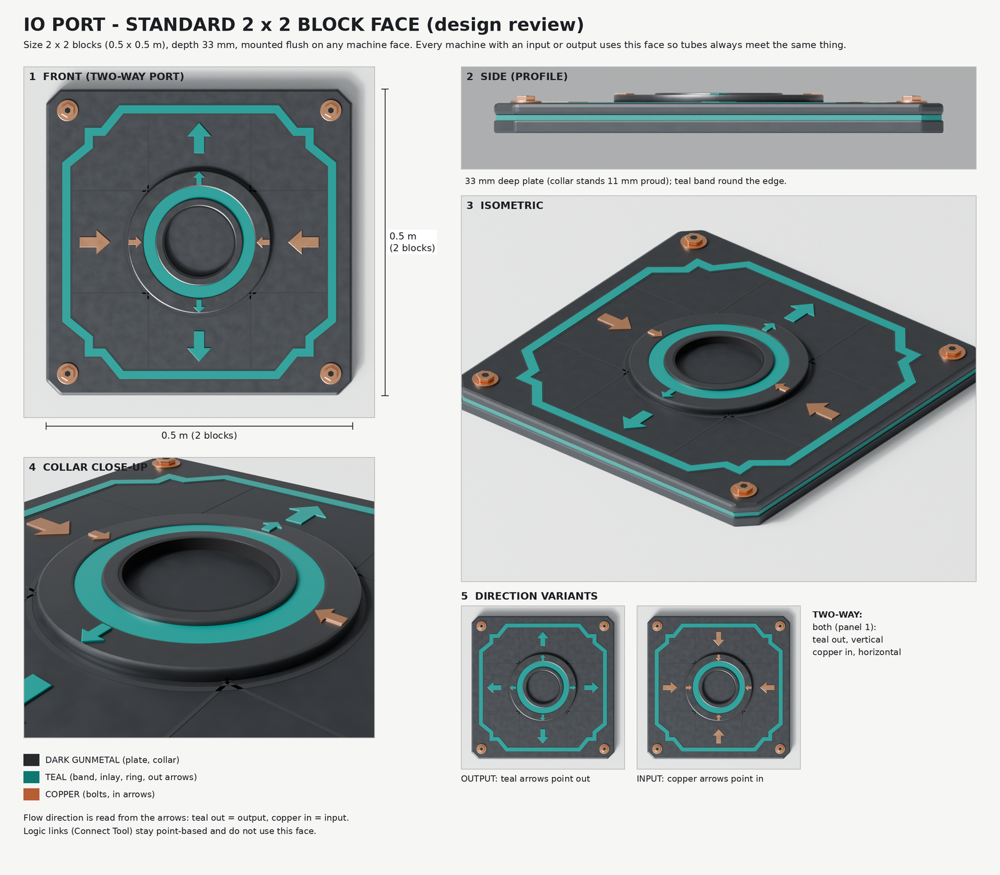

# IO Ports

Every machine that takes items or fluids in, or sends them out, carries the same IO port face where a tube
connects. The face is a standard, not an item: it is never crafted or placed on its own, and every machine
model uses it unchanged so tubes always meet the same thing.

## The standard

- **Size:** 2 x 2 blocks (0.5 x 0.5 m). The plate is 33 mm deep and mounts flush on a machine face; the
  collar in the middle stands 11 mm proud of the plate. (It was 3 x 3 until 2026-10-20 and shrank, same
  design, so it fits the ends of the 4 x 3 x 3 Gas and Battery Containers and future chests.)
- **Plate:** dark gunmetal with chamfered corners, a teal band round its edge and faint grooves
  across the face.
- **Inlay:** a teal line just inside the edge that steps inward at each corner, clear of the four copper
  corner bolts.
- **Collar:** a gunmetal ring, a teal ring and a gunmetal lip round a dark bore, where the tube seats.
- **Direction:** read from the arrows. Teal arrows pointing out mark an **output**. Copper arrows pointing in
  mark an **input**. A **two-way** port carries both: teal out on its vertical axis, copper in on its
  horizontal axis.

### Placement

Machines connect to each other and to tubes, so every machine puts its ports in the same place:

- **Floor level, same height everywhere.** The port's centre is 0.375 m above the floor the machine stands
  on: the middle of a 3-block-tall container's end. Machines, containers and chests standing side by side on
  one floor have their ports level with each other.
- **Centred on a block.** The port's centre sits on the centre of a block of the 0.25 m grid. Along the face,
  the port is centred; when the face is an even number of blocks wide, it moves half a block toward the
  machine's front.
- **Flush with the footprint.** The collar's face lies exactly on the machine's footprint boundary. Nothing
  pokes outside the footprint, and the plate sits 11 mm inside it, so the wall behind the plate is set in by
  at least that much.

A face must be at least 3 blocks wide and 3 blocks tall from the floor to carry a port.

The stations do too: the Fabricator and the Refiner have an input port on the left and an output port on the right, and
the Freezer, the Field Kitchen and the Beehive a two-way port on their right side.

Containers follow the same rule. The Small Chest (one port), Large Chest (three) and Cargo Chest (ten: three on the
front, three on the back, two on each end) carry ports, as do the Gas, Battery, Water, Chemical and Potato Ammo
Containers (one on the right end each). The Scrap Chest is too short for a port, and furniture and world containers
(Fridge, Locker, File Cabinet, Tool Cabinet, Barrel, crates, Dispenser, Broken Microwave, Ruin Chest) have none.

Logic links made with the Connect Tool are points, not ports, and don't use this face.

## Building a machine model with ports

The geometry lives in `tools/io_port/build_io_port.py`. A machine's model script imports it and calls
`mount(parent, mode, center, normal)` with `mode` set to `"out"`, `"in"` or `"both"` and `center` the port's
centre on the footprint boundary, rather than drawing its own port. `python tools/io_port/build_io_port.py --render OUT_DIR` re-renders the review sheet above.

## Item transport

Parts map E1: the ports are also data, and Vacuum Pipes join them into a network that items travel through. The host
works everything out and every move goes through the Action API, so a client sees the result like any other change.

### The data

A part lists its ports in `io_ports` (see the [Part Data Schema](part-data-schema.md#item-transport)): each has an `id`,
its `position` (m from the part's centre, part axes, front +Z) on the face its `normal` points out of, at the middle of
a block face, and a `mode`: `in`, `out` or `both` (the default), the same direction its arrows show. The containers and
stations above carry the ports their models show. A part with `"conduit": true` (the Vacuum Pipe and the Vacuum Pipe
Corner) passes items from each of its ports to the others; it holds nothing itself. A part with an `intake` (the Vacuum
Pump's mouth, the Resource Collector's funnel) reaches things in the world.

### The network

Two ports join when they sit on the same block face from either side and face each other: a pipe's end against a
chest's port, two pipe ends, or two machines' ports touching directly. From a port the network runs through every pipe
joined to it to the ports at the far ends; whatever is not a conduit is an end. Items go from one end to another only
the way the ports point: a port whose mode is `out` sends, `in` takes, `both` does either. The network is worked out
from the Creation's parts (`Mechanica.Core.Items.TransportNetwork`) and follows every change to the build, so taking a
pipe away cuts it at once. Nothing about it is saved: a save keeps the parts and what the containers hold, and the
network is worked out again when it loads.

- A **station** (the Refiner, the Fabricator, the Freezer, the Field Kitchen, the Beehive) takes a craft's inputs from the containers piped to its
  input port, as well as from the player and the containers next to it, and puts what it makes into the containers
  piped to its output port, then into itself. A Refiner piped from a Resource Collector refines what the collector
  gathers. A station that works on its own (`crafting.auto`, the Beehive) needs no order: a chest piped to its port keeps
  it fed with Pigment Flowers and takes the Beeswax it makes.
- The **Vacuum Pump** (on a logic signal) sucks the nearest thing in reach of its mouth into the containers its back
  port sends to: a pile on the ground, a loose resource piece (a log, a rod, a chunk), a ripe crop (its soil's script
  harvests it, `on_collect`) or water (only into containers that accept full Water Buckets, so a Water Container). Set
  to Eject, it throws items from those containers out of its mouth as a pile.
- The **Resource Collector** pulls loose resources and piles within 12 blocks of its top into itself; its output port
  sends them on.

Part scripts drive the machines with generic primitives (`part.network`, `part.pickups`, `part.collect`,
`part.eject`; see the [Lua API](lua-api.md)), which dispatch the host's `CollectItems` and `EjectItems` actions; the
read-only `GetNetwork` and `GetPickups` actions show the same to tools and AI clients.

### Not yet

- **Pipe length.** A Vacuum Pipe is a 1-block straight piece; a run is pipes placed end to end, turned with the Vacuum
  Pipe Corner. Scrap Mechanic's drag-to-length placement (parts map E12) is not built.
- **Other liquids.** Only water is pumped (as full Water Buckets). Chemicals and oil are left for later.
- **Placing blocks.** An ejecting pump throws items as a pile; it does not place blocks or parts as Scrap Mechanic's
  does.
