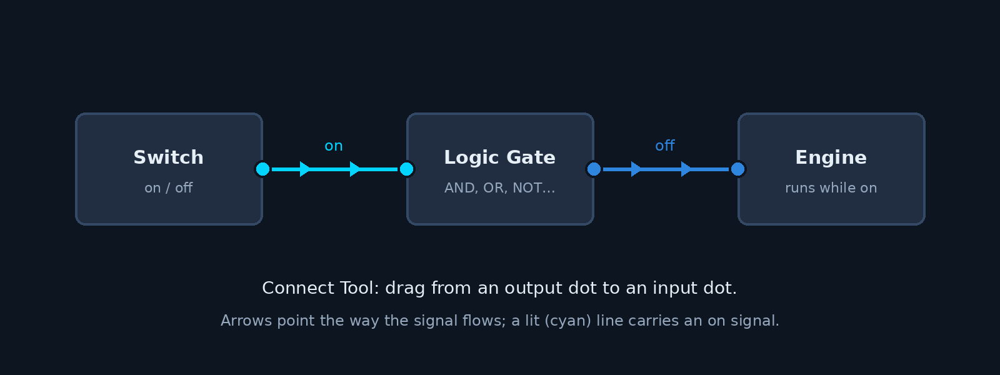

# Logic and Power Tutorial

Seats, engines, switches and timers talk to each other over the **logic bus**. You wire them with
the **Connect Tool**, watch the wires with the **Logic Visualizer**, and look inside a creation with
the **Creation Inspector**. This tutorial builds a drivable car, then a switch that works a piston, and
ends with what a modder needs to make new logic parts.

## How signals work

- Every logic part has one **output**: a number, 0 when it is off. A switch outputs 1 while it is on,
  a driver's seat outputs its throttle from -1 (back) to 1 (forward).
- A **link** goes from one part's output to another part's input, inside one creation. A part's
  **input** is the sum of the outputs of every part linked to it.
- A signal moves one link per physics step (1/60 s). A switch that feeds a timer that feeds a piston
  reaches the piston two steps after you flip it.
- How many links a part takes and sends is in its data. A seat sends up to 10 (the Scrap Driver's Seat
  only 4), an engine takes up to 4 and sends up to 10, a bearing or a piston takes up to 4.
- What a signal means is up to the part that receives it. An engine reads its input as a throttle, a
  piston pushes out while its input is not 0, and a logic gate counts every input that is not 0 as on.
- Links are saved with the creation and copied with it. Taking a part off removes its links, and when
  a creation breaks in two, a link between the two pieces is lost.



## The tools

| Key | What it does |
|-----|--------------|
| 7 | Takes the **Connect Tool** in hand. While it is in hand every part with logic shows a round **node** and you see every link nearby. Nodes are blue for logic (switches, gates, seats, lights), cyan for power (engines, thrusters, rotors), white with a blue ring for bearings and pistons, and gray for structural parts. A node pulses cyan while its part's signal is on. A part linked to a seat or a controller shows its order number for each (1 is the first part that seat or controller was linked to). In Survival the Connect Tool is an item: you start with one, it is never dropped when you die, and a Fabricator makes more from 5 Scrap Metal Blocks and 2 Circuit Boards. Without one it does nothing. |
| Left drag (Connect Tool) | Press on a node and drag: a line follows your aim and snaps to the nearest node it can end on within half a metre. Nodes it cannot end on (another creation, a part with no free input, a kind the part does not take) fade. Let go on a node to link the two, or on a part it already feeds to take that link away. Every bearing you drag over on the way is linked too, so one drag from an engine wires all its wheels. |
| Left drag on a line | Grabs the line's far end. Let go in the air to disconnect it, or on another node to move it there. |
| Right click (Connect Tool) | On the node of a bearing that something drives (a seat, a controller or an engine is linked to it), reverses which way it turns (the small curved arrow by the node flips). During a drag, cancels it. |
| Hover (Connect Tool) | On a node, a tooltip shows the part and its kind; on a line, "Source → Target" and its signal. |
| E | On a part with settings, opens its menu (a timer's delay, an engine's power). On a logic gate it switches to the next mode. R with the Connect Tool opens any part's menu. |
| F7 | Turns the **Logic Visualizer** on or off: links show without the Connect Tool. Each link is a blue line with a cyan core (bright while the source is on) and chevrons pointing from the source to the part it feeds. With both off, a link flashes briefly when its signal changes. |
| F8 | Opens the **Creation Inspector** for the creation under the crosshair: its mass, bodies, joints, links, and for each part its output, input, settings, who sits in it and whether its script runs or stopped on an error. |
| F9 | Turns the **force overlay** on or off: an arrow for every push a part script makes, such as a thruster's thrust or a wing's lift (see the [Aero and Propulsion Tutorial](aero-tutorial.md)). |
| E | Uses what you look at: sit in a seat, flip a switch, press a button. While seated, E stands you up. |

Every change goes to the host, which checks it (you must be within reach of both parts, and both ends
must have a free link) and sends the result to everyone. The visualizer and the inspector read the
host's signals, so a client sees exactly what the host simulates.

## Build a car

You need a driver's seat, a gas engine, five bearings, four wheels and some metal blocks. In Survival
you also need a gas container with gasoline in it; in Creative engines run without fuel.

1. **Chassis.** Lay a row of five metal blocks. The car will drive along the row.
2. **Seat and engine.** Put the driver's seat and the engine on top of the chassis, both facing the
   same way. An engine rolls its wheels toward its front (the side with the small block on it), and the
   seat faces the same way when its back is behind you.
3. **Rear wheels.** Under the back block hang two more blocks, put a bearing on each side of the lower
   one with its rotor facing out, and put a wheel on each rotor by its hub.
4. **Steering.** Under the front block put a bearing with its rotor facing down, a block under the
   rotor (the axle), and a bearing and a wheel on each side of the axle as at the back. The upright
   bearing is the steering bearing.
5. **Wire it.** Take the Connect Tool. Drag from the seat's node to the engine's, then from the seat to
   the steering bearing: the seat now feeds both. Drag from the engine across all four wheel bearings;
   each one you pass over is linked.
6. **Power.** Aim at the engine and press E. Low (1) is slow and easy to control; High (5) is the top
   speed (`speed` in the engine's data). Each step is a fifth of it. The menu also shows the fuel left,
   the gasoline in the tanks, the wheel speed in rpm and the torque.
7. **Drive.** Look at the seat and press E. W and S are the throttle, A and D steer. With no throttle
   the engine holds the wheels (its `brake`), so the car does not roll away. E stands you up.

If the car drives backwards, the engine faces the wrong way: turn it round. If one wheel turns against
the others, right click its bearing's node with the Connect Tool to reverse it. If it steers the wrong way,
the steering bearing is at the back (or right click it to reverse it). A seat only steers bearings that turn about an upright axis, and an
engine only drives bearings whose axis is across its front, so linking the seat to a wheel bearing or the
engine to the steering bearing does nothing.

While the engine runs, a green dot above it shows it is on (gray when it is off), and a cyan ring turns on
each wheel bearing it drives. With the Connect Tool out a piston shows a bar of how far out it is.

An engine with nothing linked into it has an **On** toggle in its menu: on, it drives at full throttle.
Link the seat back in and the toggle gives way to the seat.

### Fuel

A gas engine burns one gasoline from the creation's gas containers for every 40 s of full throttle
(half throttle lasts twice as long). When the last one is gone it sputters and stops until you fill a
container again. The Electric Engine draws battery packs from batteries the same way, and its upgrades go further on each pack. The Creation
Inspector shows an engine's input, so you can tell an empty tank from a broken wire.

## A switch and a piston

1. Put a switch and a piston on a block, and something on the piston's head.
2. With the Connect Tool, drag from the switch's node to the piston's.
3. Look at the switch and press E. The piston pushes out to the end of its stroke and holds there.
   Press E again and it pulls back.

Put a **timer** between them (switch → timer → piston) and set its delay with E: the piston moves that
many seconds after the switch. Set its Trigger to **repeat** and the piston pumps in and out every delay
while the switch is on. Use a **button** instead of the switch for a short pulse, or a **logic
gate** to need two switches at once.

## The vanilla logic parts

Settings are changed with E on the part; properties are fixed in the part's data.

| Part | Output | Settings | Properties |
|------|--------|----------|------------|
| Driver's Seat, Scrap Driver's Seat | The driver's throttle, -1 to 1 | | `steer_angle` (°), `steer_speed` (rad/s), `steer_torque` (N·m) |
| Passenger Seat, Scrap Seat | (none) | | |
| Gas Engine, Scrap Gas Engine, Electric Engine | Its throttle while it runs | `gear` (Power, Speed on the Electric Engine) 1 to `gears` (4 on the Scrap Gas Engine, 5 to 13 on Gas Engine and Electric Engine 1 to 5), `on` (every engine needs it) | `speed` (rad/s at full power), `torque` and `brake` (N·m), `fuel` (item), `fuel_time` (s per item), `loop_parameter`, and the `ignition` timings |
| Logic Gate | 1 or 0 | `mode`: and, or, xor, nand, nor, xnor | |
| Timer | Its input, `delay` seconds later; or on and off every `delay` while its input is on | `delay` (s), `mode` (once, repeat) | |
| Sensor | 1 while something it detects is within `range` of its face | `range` (1 to 20 m), `players`, `bots`, `blocks`, `creations` | `interval` (steps between checks), `cone` (°) |
| Switch | 1 while on; E toggles it | | |
| Button | 1 for `pulse` seconds after E | | `pulse` (s) |
| Controller | 1 while it runs | `frames` (up to 10), `frame_time` (s), `loop` | `speed` (rad/s), `torque` (N·m), `force` (N) |

The **controller** steps the bearings and pistons it is linked to through its frames while its input is
on: every `frame_time` seconds it moves to the next frame, and starts over when `loop` is on. In its
menu the timeline along the top picks a frame; Add frame copies the picked one after it and Remove frame
deletes it. Each frame lists every joint the controller feeds with its target (an angle in degrees for a
bearing, metres out for a piston) and its speed. Play runs the frames on the creation so you can see
them; nothing changes until you press Apply or close the menu. It is how you make doors, arms and
walking legs.

The **sensor** looks out of its face in a narrow cone. Its menu shows the cone while it is open, and the
Detects toggles pick what turns it on: players, bots, blocks (the ground and the world's objects) and
creations. Anything else in the way still blocks its view.

Link a seat to switches and buttons and they go on your hotbar while you sit there, so you can work a
crane or open a door from the driver's seat. Number keys use them, and Left and Right click use the first
two. A controller linked from a seat starts on W and stops on S.

A logic gate counts each input that is not 0 as on. With no inputs everything is off, so nand, nor and
xnor are on. xor is on when an odd number of inputs are on.

## Making logic parts

A logic part is ordinary part data plus a script (decision D2: the behaviour is Lua, the game only
moves the signals). Start from the **logic**, **seat**, **engine** or **wheel** template in the Part
Editor. The keys are in the [Part Data Schema Reference](part-data-schema.md#logic-settings-and-seats):

```json
"script": "scripts/timer.lua",
"logic": { "inputs": 10, "outputs": 10 },
"settings": [
  { "id": "delay", "name": "Delay", "type": "number", "min": 0, "max": 60, "step": 0.05, "default": 1 }
]
```

The script reads its input and sets its output (see the [Lua API Reference](lua-api.md)):

| Lua | What it does |
|-----|--------------|
| `on_power(amount)` | Runs when the sum of the part's inputs changes. |
| `get_outputs()` | Returns the part's output each step (a number, or a boolean as 1 or 0). |
| `part.set_output(value)` | Sets the output directly instead. |
| `part.input()`, `part.inputs()` | The sum of the inputs, or each one as `{part, value}`. |
| `part.links()` | The parts this part feeds (an engine's wheel bearings). |
| `part.setting(id)` | The value of one of the part's settings. |
| `on_activate(peer)` | A player pressed E on the part (give it `logic.use` so E offers it). |
| `part.occupant()`, `part.occupant_input()` | For a seat: who sits in it and what they press. |
| `creation.take(item, count)` | Burns fuel from the creation's containers. |
| `world.creative()` | True in Creative, where engines need no fuel. |

The vanilla scripts in `mods/vanilla/scripts/` (`seat.lua`, `engine.lua`, `logic_gate.lua`,
`timer.lua`, `sensor.lua`, `switch.lua`, `button.lua`, `controller.lua`) are short and make good starting
points.

### Wheels

A wheel is a part with one structural socket, its hub, and a cylinder collision along its local Y. Put
it on a bearing's rotor by the hub and it turns with the bearing. Its `friction` is its grip. The vanilla
wheels are 3 × 1 × 3 cells (the Big Wheel 5 × 2 × 5); placing centres a wide part on the face you aim
at.

### Directions

A placed part's front is its local -Z and its top its local +Y. An engine works out the sign for each
wheel bearing from the bearing's axis: a positive bearing velocity turns right-handed about the axis
(see the [Socket and Joint Guide](socket-joint-guide.md)), so a wheel on the right of a car rolls it
forward with a negative velocity and one on the left with a positive one. A seat steers right by
turning its upright bearings clockwise seen from above.
