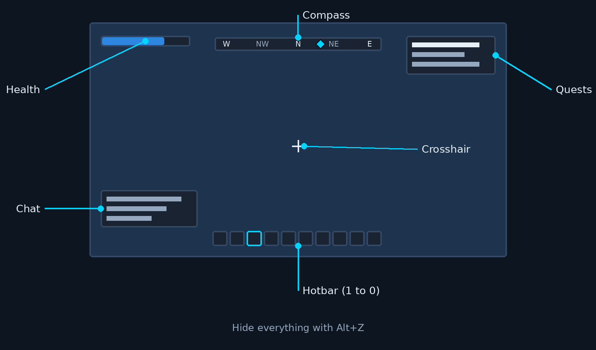
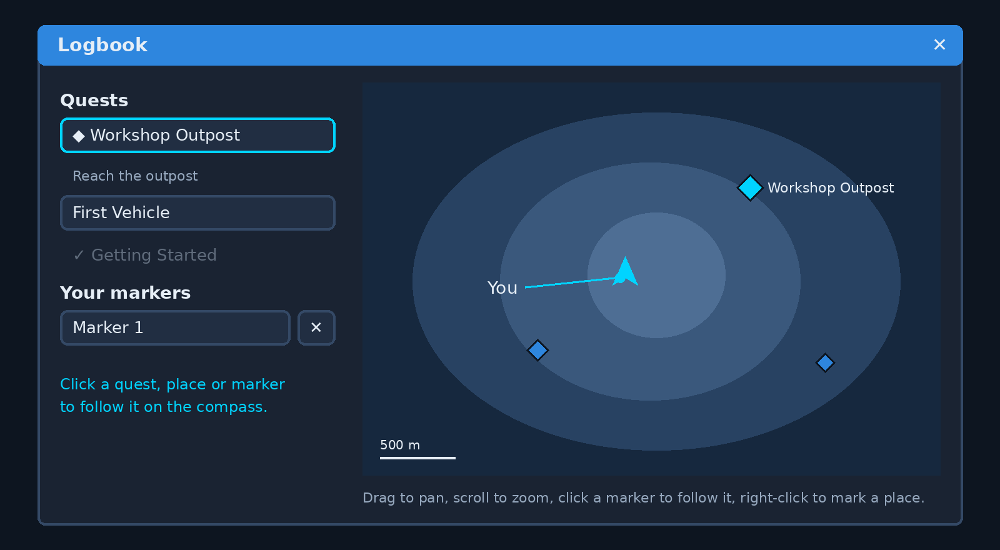

# How to Play

You start at the crash site. The quest log says what to do next, and Use (**E**) does most things in
the world. Press **H** (or **F1**) at any time to open this Handbook. It opens at the page you read last
(the first time, on the page for what you are doing: the Logbook, your inventory, the Part Editor, ...).
The arrow keys (or Page Up and Page Down) and the buttons under the page turn pages, and the box at the
top searches every page.

## Controls

These are the default keys. Every one can be changed in Options, Controls.

| Key | What it does |
|-----|--------------|
| W A S D | Walk |
| Space | Jump. In deep water, swim up; at the surface, jump out. |
| Shift | Sprint (and swim faster) |
| Ctrl | Crouch: move slowly and fit under gaps 1.2 m high (you stand up again once there is room). In deep water, dive. |
| Mouse | Look. Click the world to take the mouse back after a menu. |
| X / C | Zoom the camera in or out a step (also Alt + scroll). You start in third person over the shoulder; all the way in is first person. |
| V | Watch players: the camera follows another player, an AI player first, and shows what the AI is thinking. Left and right click go to the next and previous player, X and C zoom between their own view and behind them, and V or Esc gives your view back. You stand still meanwhile. |
| 1 to 9, 0 | Pick a hotbar slot. It starts with the Sledgehammer (in hand), Lift, Weld, Paint and Connect Tool. |
| Left click | Create, attack or place: with a part in hand it goes down when you let go, the Sledgehammer swings. With a part in hand, hold still to lock the ghost (arrows show the ways it can grow), then drag to lay a grid of up to 16 by 16 parts; Q steps the grid's plane while you drag. Hold and drag with the Paint Tool to paint every part you pass over, or with the Weld Tool from one part to another to weld them. |
| Right click | Remove or pick up: hold it on a part with a part or nothing in hand until the ring round the crosshair fills (wood is quickest, metal slower); let go early to stop. Drag with it held to remove the parts of one body across a face. Hold it with the Lift to take the Lift away, with the Sledgehammer to block (Creative only), and with the Paint Tool to take paint off (drag for more). Right click on items lying on the ground picks them up at once, whatever is in hand. With a weapon in hand, hold it to aim: the view zooms in a little and the crosshair tightens. |
| Scroll | Previous or next hotbar slot |
| Q / Shift + Q | Turn the part (a part in hand, Weld, Lift). With the Paint Tool, Q opens the colour picker and Shift + Q picks the previous colour. |
| T | A part in hand and Weld: tip the part over |
| Up / Down arrows | Raise or lower the Lift |
| G | Drop one of the item in hand |
| F (hold) | Force build: hold it and left click to put the item in hand (food, a bucket, a glowstick) where you aim, where it stays. Also hold it while dragging a stack out of the inventory to drop it. |
| R | Reload the weapon in hand |
| E | Use. Hold it on a tree or rock node (they get a blue outline) until the ring fills (5.2 s) to refine it: you draw the Refine Tool and scrape at it, and what it gives goes straight into your inventory. Letting go or walking away stops it. The Refine Tool is not an item: it is never in your inventory or on the hotbar. Also: open the blueprint menu (the Lift in hand, aimed at your Lift), open a container or station, pick up items, harvest, sleep in a bed, sit in or leave a seat, use a part, change a part's settings, use a quest marker, talk, respawn after dying |
| I or Tab | Inventory |
| U | Upgrade the part you are aiming at (a station), or the station whose screen is open |
| L | Logbook: your quests, the map and your markers; you pick an answer here when a quest asks you to decide |
| Esc | Menu: save, load, open your world to the LAN, Options, help, quit. Esc also closes any open window. |
| H or F1 | Handbook |
| Left / Right (or Page Up / Page Down) | Turn the Handbook's pages |
| F7 / F8 / F9 | Logic Visualizer, Creation Inspector and force overlay |
| Alt + Z | Hide the HUD (crosshair, tool bar, compass, tips, chat, quest log and names), and show it again |

In water deeper than about chest height you swim: there is no ground to stand on, you float with your
head out, Space rises and Ctrl dives. Shallower water slows you down.

While a menu or the inventory is open, your character stands still, and a Creation you are driving
stops getting your input.

### Seats and part menus

E on a seat sits you down: you glide into it, and the camera turns to face the way the seat faces. Ctrl
switches between a chase view behind the creation and the view from the seat, and the camera turns with
the creation. E stands you up beside the seat, in the first free spot to its left, right, front or back.
A seat someone else sits in says "Seat occupied".

While you sit, the switches and buttons the seat is linked to take the hotbar's place. 1 to 9 and 0 use
one at once, Left click uses the first and Right click the second, wherever the part is on the creation. A
slot glows and pulses while its part is on.

E on a part with settings opens its menu: sliders with a field for numbers (with preset buttons on some,
like an engine's Low, Medium and High), drop-downs for choices, and what the part reports, such as an
engine's fuel and speed. A sensor shows the cone it sees while its menu is open. A controller's frames
take effect when you press Apply or close the menu, and Play previews them first. E on a logic gate
switches it to the next mode and shows it for a moment; R with the Connect Tool opens its menu.

## The HUD

- The **crosshair** is white, turns blue when a click or Use would do something where you aim (a valid
  place for the part in hand, something to use), and pulses cyan over a connection node when you hold the
  Connect Tool (see the [Logic and Power Tutorial](logic-power-tutorial.md) for dragging links).
- Aim at a part for a moment and a **tooltip** shows its name, what it is and what Use does. Parts you can
  use, sit in, open or set up add a line with their signal (on or off), how many connections they have and
  their durability.
- **Health** is the blue bar at the top left (Survival). The quest log is at the top right, the compass at
  the top, the tool bar at the bottom and chat at the bottom left.
- A part in hand shows a **ghost** that is blue where the part fits and red where it would not (something in the way, out of
  reach, or none left in Survival). A part you place shows straight away; if the host turns it down, it fades out
  red.
- **Tips** show at the bottom of the screen, above the hotbar; hold Use (**E**) to dismiss one early.
- If the game window loses focus, anything you are holding down (such as dismissing a tip) is cancelled.

## Lift, Weld Tool, Paint Tool and Sledgehammer

- **Lift.** Left click on the ground puts your Lift down (you have one; putting it somewhere else moves it).
  It is a hydraulic lift with a 4 x 4 unit (1 m) grated platform: set down, its four outriggers swing out and
  lock and the column rises to its resting height of 2 units (0.5 m).
  Left click a Creation to slide the Lift under it and pick it up; it stands still on the platform until you
  take the Lift away. The arrow keys raise and lower it one unit (0.25 m) at a time, up to 20 units above its resting height
  (the deck at 22 units, 5.5 m); hold an arrow and the column runs smoothly until you let go, stopping at the next
  unit. Standing on the deck you ride it, and the arrow keys drive it whatever you have in hand. Q turns what it holds. Aim at the Lift (or
  what it holds) and hold right click until the ring fills to pick the Lift back up; what it held drops. A Creation whose chests or tanks hold items cannot be
  lifted ("Cannot lift with attached resources."): empty it first.
- **Blueprints.** With the Lift in hand, aim at your Lift and press **E**. The menu lists your newest 50
  blueprints with a picture of each. Type a name and **Save** to keep what the Lift holds (saving over a name
  asks first); choose one and **Load** to build it on your empty Lift. In Survival loading takes the parts
  from your inventory, so you need one of each; what was in chests and any damage are not saved. **Delete**
  asks before it removes a blueprint. Blueprints are files in your user folder (`user://blueprints/`).
- **Weld Tool.** Click a part to select it (it gets a blue outline), then click a part of another Creation to
  move the first one there and weld them, or a touching part of the same Creation to weld the two bodies
  together. Or hold left click on the first part and let go on the second. A blue square shows where they will
  join, a see-through copy shows where a moved Creation goes (Q and T turn it): green where the weld will take,
  red where it would be refused (the parts do not touch, it would overlap or hit something, it is out of reach).
  While a part is selected you hold the tool up. On a weld its clamping arms close round its tip, the tip spins,
  blue sparks fly at the joint and a blue seam glows on the joined faces for a moment afterwards. Right click drops
  the selection. What is built on the ground stays put: select the loose Creation first and weld it to a block
  built on the ground to fix it in place (fewer moving bodies, less physics work). The drag works on a Lift too,
  to weld touching parts on different bearings or to put back a piece that fell off. In Survival the Weld Tool is
  crafted at a Fabricator (10 Metal Blocks and 2 Component Kits, 30 s) and you keep it when you die.
- **Paint Tool.** Left click paints a part; hold and drag to paint every part you pass over (up to 256 at a
  time). Right click (or drag) takes the paint off. **Q** opens the colour picker round the cursor: move the
  mouse towards a colour and click, or press 1 to 0 for the first ten. Esc or Q again closes it.
- **Sledgehammer.** Your main tool and only starting weapon: it is always on the hotbar (you can move it to
  another slot but never take it off, drop it or store it) and you keep it when you die. Left click swings it:
  overhead, or sideways from the right or the left, at random. A swing every 0.6 s, and the blow lands the moment
  you click, on whatever is under the crosshair within 3 m, the ground included (that only thuds and kicks
  up dust). Hold left click to keep swinging; you can walk, run and jump while you swing. Every hit pushes what
  it lands on along the swing (5000 N·s, but never faster than 4 m/s, so light things don't fly off): a part's
  body, a player or a bot, which also take 20 damage in Survival. It chips at trees and rocks (a rock node takes
  25 a hit) until they break into what they drop, and wears parts down until they break off. It throws dust,
  chips and sparks and gives the camera a small jolt. In Creative, hold right click to raise the hammer across
  your chest: a block pose others see, which changes no damage and no knockback. Survival has no block. Timing,
  reach, damage and knockback are the `sledge` section of `game/data/building.json`; each world object's own
  hit damage is its `sledge_damage` in `worldgen.json`.

## Hotbar and inventory

The **hotbar** is the row of ten slots at the bottom of the screen. Each slot holds a tool, a part or an
item, and shows its picture, how many you carry (Survival) and its key. Pick a slot with **1** to **0** or
the scroll wheel; the slot picked has a bright cyan border. A tool slot puts that tool in hand, a part slot
puts that part in hand ready to place, an empty slot leaves your hand empty (it still removes parts), and any
other item (food, seeds, a weapon) goes in hand. The Sledgehammer never leaves the bar.
In Survival, something you pick up for the first time goes in the first empty slot. Your hotbar is saved
with the world. A weapon's slot shows its ammo instead: the rounds loaded out of its magazine (the Potato
Blaster holds 15, the Scattergun 4), or the potatoes you carry for one that does not reload. With it in hand,
the counter at the bottom right shows the rounds and the potatoes; when it is empty, **R** reloads it from
the potatoes you carry (the ring round the crosshair fills while it does).

The **inventory** (**I** or **B**) is a grid of six columns with tabs along the top: All, Blocks,
Interactive, Tools, Resources and Consumables.

- Drag a stack onto the hotbar to put it in a slot, onto another slot to move it, or onto the other side
  when a container is open. Drag a hotbar slot onto another slot to swap them, or onto the inventory or
  off the bar to empty it.
- Click a stack to pick it up and click a slot to put it down. **Right click** picks up half a stack and
  **Shift + right click** one; **Shift + click** sends a stack straight to the other side.
- Hold **Force build** (**F**) and drag a stack out of the window to drop it on the ground.
- Hover a stack for its name, description, how many are in the stack and its durability.
- In **Creative**, every part and tool is listed under the grid; drag one onto the hotbar, or into your
  inventory for a full stack.
- In **Survival**, a warning shows at the top when only a few slots are free.

**Stations.** Use (**E**) on a Fabricator or another station to open its screen in three columns. On the
left are its recipes, with a search box and the same category filters; a recipe you can't afford yet is
dimmed. The middle shows the chosen recipe: what it makes, how long it takes and what it needs (red when
you are short), a quantity and **Craft**, then the queue with a progress bar and the time left for each
order (Cancel gives the inputs back), and the station's output slots. On the right are your inventory and
the station's **linked storage**: any chest built on the same Creation right next to the station (a
pipe joins them). Crafting takes inputs from linked chests first, then from you, and puts what it makes
in a linked chest when there is room.

**Upgrades.** Press **U** (or **Upgrade** on the station's screen) to see what the next level costs and
what it changes, such as speed, queue length and slots. Upgrades cost Component Kits in Survival and are
free in Creative.

## Options

**Options** is on the main menu and in the menu (Esc). Its tabs:

- **Controls**: every action with a primary and an alternate key. Click a key, then press the new key
  or mouse button (Esc cancels). If another action already has it, choose **Swap** to trade keys or
  **Overwrite** to take it; actions that share a key show in red. Search at the top; each category and
  the whole list can be reset.
- **Graphics**: resolution, display mode (windowed, borderless, fullscreen) and VSync, which change
  when you press **Apply** and go back after 15 seconds unless you keep them; a quality preset (Low,
  Medium, High, Ultra, or Custom for view distance, shadows, anti-aliasing, textures and effects); UI
  scale from 75% to 150%. View distance (128 to 1024 m) is how far you see: the ground around players
  is simulated out to 128 m, and past that the land and its rocks and trees are drawn as scenery you
  can't touch, fading into fog at the view distance.
- **Audio**: master, music, sound effects and interface volume, mute all, and the output device.
- **Gameplay**: over a world, its difficulty (chosen in New Game, see [Survival](survival.md#difficulty)); mouse sensitivity, invert Y, field of view, tutorial hints (a short tip at the bottom of
  the screen the first time you start, pick up each tool or open each screen; **Show tips again** brings
  back the ones you have seen; the tips are in `game/data/tutorial.json`), auto-save (off, or every 5, 10 or 15
  minutes while you host), the most players a world you host takes, the server password for worlds you host, and your player name.
- **Interface**: show or hide the tool bar and key hints, the compass, other players' names over their heads, how opaque the chat background is, and a
  colour-blind filter (Protanopia, Deuteranopia or Tritanopia) that corrects colours on the whole screen
  so ones that look alike stay apart, and the **Language** of menus and the HUD. The game ships in English; a
  language file dropped into your `lang` folder (Options shows where) adds that language to the list. See
  [Translating](translating.md).

Everything else applies as you change it. **Reset to Defaults** resets the open tab after asking, and
closing Options saves your settings in `settings.json` in the game's user data folder. Settings are
yours alone: they never change the world or other players' games.

## Your character

The first time you play in a world you choose the **Male Scrapper** or the **Female Scrapper** (on the New
game screen when you start the world, or in a window when you join one). They move and play the same; the
choice is kept for you in that world and everyone sees it. See [Player Characters](characters.md).

## Logbook

Press **L** to open the Logbook, and L, Esc or its X to close it. On the left are your quests: each one you are
working on with its current step and progress, and the ones you have finished greyed out under them. When a
quest asks you to decide, its answers are buttons under it. Then come the places quests have shown you and
your own markers.

On the right is the map of the island. Drag it to move around and turn the mouse wheel to zoom in on the
cursor; **−**, **+**, **Whole map** and **Find me** do the same with buttons. The cyan arrow is you, pointing
the way you face. Blue diamonds are quest goals (they pulse), places found and your markers; hover over one for
its name and distance. Click a diamond, or a quest, place or marker in the list, to make it the compass's
primary waypoint (it pulses cyan) and centre the map on it. Right-click the map to mark a place: it shows on
the compass and in the world like any waypoint. Right-click one of your markers (or its ✕ in the list) to
remove it. Your markers are saved with the world; you can have up to 20. The map keeps where you left it.

## Compass

The bar at the top of the screen shows which way you face, with the points and a tick every 15°. Blue
diamonds are your quest goals and the places you have found, with the distance under them within 500 m;
the primary one is larger and pulses cyan. With the logbook open (the mouse is free), click a diamond to
make it primary. A goal behind you sits at the edge you are nearer turning to, with an arrow. Within
100 m a diamond also floats over the place itself. The compass hides while the inventory or menu is open,
and Options, Interface, Show compass turns it off.

## Playing together

Everyone plays in one world: the host's. From the menu (Esc), **Open to LAN** lets players on your
network join; they see your world under **Join game** in the main menu, or can type your address and
port (27460 unless you changed it). Players outside your network join by address once the port is
forwarded to you. Quest progress is shared by everyone in the world.

Press **Enter** (Chat) to talk: type a line and press Enter to send it, or Esc to close. Lines show
bottom left with the speaker's name in cyan and fade after a few seconds; open chat to scroll back. A line
is at most 200 characters and each player may send 5 every 10 seconds. Chat is the `SendChat` action, so
agents on the AI endpoint can talk too.

When another player has a Fabricator, chest or other station open, sits in a seat, or has their Lift out, a
small blue **in use** icon with their name floats over it. You can still open a station someone else is using;
the icon just says you're sharing it. The icons fade with distance and hide with the HUD (Alt + Z).

To keep strangers out, set a **Server password** in Options, Gameplay (or start with `--password text`).
Players then type it in the password box on **Join game**; the list marks worlds that need one. A changed
password counts from the next player who joins. The password is sent unencrypted, so don't reuse a real one.

## Saving

Only the host saves. **Save game** in the menu writes the world, every player's inventory, health and
bed, and the story, to a file named after the world. **Load game** in the main menu starts it again. See
[Saves](saves.md).

## More

- [Survival](survival.md): health, items, crops, water and beds
- [Quests and Dialogue](quests.md)
- [Logic and Power Tutorial](logic-power-tutorial.md): seats, engines and wiring
- [Getting Started](getting-started.md) with the Part Editor
